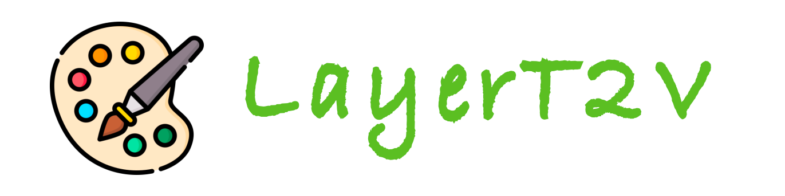
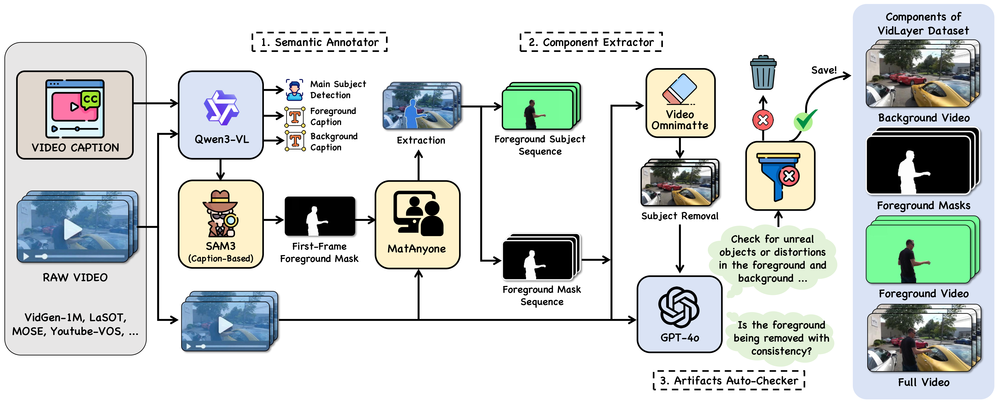
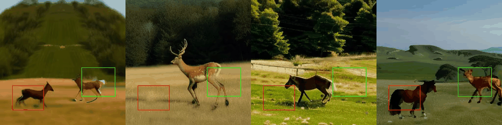
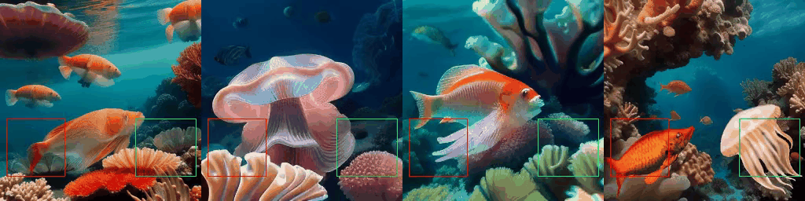

<p align="center">
  
</p>
<div align="center">

## LayerT2V: A Unified Multi-Layer Video Generation Framework

[](https://kr-panghu.github.io/LayerT2V/assets/pdf/LayerT2V.pdf) &ensp; [](https://arxiv.org/abs/2508.04228v2) &ensp; [](https://kr-panghu.github.io/LayerT2V/)

</div>

## 🚀 News

* **[Feb. 2026]** Release [LayerT2V v2](https://arxiv.org/abs/2508.04228v2) on arXiv, where we adopt Wan2.1 Video as our backbone and introduce training-wise paradigm for layer-aware video generation.
* **[Aug. 2025]** Release [LayerT2V](https://arxiv.org/abs/2508.04228) on arXiv.

## 📖 Intro

Text-to-video generation has advanced rapidly, but existing methods typically output only the final composited video and lack editable layered representations, limiting their use in professional workflows. We propose **LayerT2V**, a unified multi-layer video generation framework that produces multiple semantically consistent outputs in a single inference pass: the full video, an independent background layer, and multiple foreground RGB layers with corresponding alpha mattes. 


We also introduce **VidLayer**, the first large-scale dataset for multi-layer video generation. Extensive experiments demonstrate that LayerT2V substantially outperforms prior methods in visual fidelity, temporal consistency, and cross-layer coherence.




LayerT2V generates high-fidelity multi-layer videos across three generation modes: 

1. single-foreground with a single subject, 
2. single-foreground with multiple subjects, 
3. multi-foreground joint generation with independent layers. 

Our method produces clean foreground separation, sharp alpha mattes, and complete backgrounds without leakage or boundary artifacts across diverse scenes and motion patterns.


<!-- Comparisons with other methods:

* The bounding box on the video shows the input trajectory, our method demonstrates the best bbox-alignment and also prompt-alignment.
* Since our method generates videos in a layer-to-layer manner, visual quality of generated results are guaranteed.

<table align="center" style="width:768px;">
  <tr>
    <td align="center" width="192">MCtrl<sup>[1]</sup></td>
    <td align="center" width="192">Peek<sup>[2]</sup></td>
    <td align="center" width="192">Dav<sup>[3]</sup></td>
    <td align="center" width="192">Ours</td>
  </tr>

  <tr>
    <td colspan="4" align="center">
      <br/>
      A deer and a horse running on the grassland.
    </td>
  </tr>

  <tr>
    <td colspan="4" align="center">
      <br/>
      A duck and a stone floating in the pond of a park.
    </td>
  </tr>

  <tr>
    <td colspan="4" align="center">
      <br/>
      A corgi and a robot running on the beach.
    </td>
  </tr>

  <tr>
    <td colspan="4" align="center">
      <br/>
      Two geese swimming in the lake.
    </td>
  </tr>

  <tr>
    <td colspan="4" align="center">
      <br/>
      A deer and a bear running on the grassland with a cabin in the distance.
    </td>
  </tr>

  <tr>
    <td colspan="4" align="center">
      <br/>
      A jellyfish and a carp in the ocean.
    </td>
  </tr>
</table> -->


<!-- ### References

~~~
[1] Wang Z, Yuan Z, Wang X, *et al.* MotionCtrl: A unified and flexible motion controller for video generation. In: *ACM SIGGRAPH Conference Papers*, 2024: 1–11.  
[2] Jain Y, Nasery A, Vineet V, *et al.* Peekaboo: Interactive video generation via masked diffusion. In: *CVPR*, 2024: 8079–8088.  
[3] Yang S, Hou L, Huang H, *et al.* Direct-A-Video: Customized video generation with user-directed camera movement and object motion. In: *ACM SIGGRAPH Conference Papers*, 2024: 1–12.
~~~ -->


## ✨ Citation <a name="cite"></a>
```
@article{cen2025layert2v,
  title={LayerT2V: Interactive Multi-Object Trajectory Layering for Video Generation},
  author={Cen, Kangrui and Zhao, Baixuan and Xin, Yi and Luo, Siqi and Zhai, Guangtao and Liu, Xiaohong},
  journal={arXiv preprint arXiv:2508.04228},
  year={2025}
}
```